 

 

### `$ cat stack.conf`

<table>
<tr>
<td width="25%" valign="top">

**🧬 biotech**

`SNP Analysis` 
`Bioinformatics` 
`Machine Learning` 
`DSP`

</td>
<td width="25%" valign="top">

**🔌 hardware**

`4-Layer Linux SBCs` 
`ECG` 
`LoRa` 
`Embedded C`

</td>
<td width="25%" valign="top">

**💻 software**

`Python` 
`C++` 
`Cybersecurity` 
`Virtualization`

</td>
<td width="25%" valign="top">

**🖧 infra**

`Self-Hosted HPC` 
`Linux` 
`Networking` 
`Proxmox`

</td>
</tr>
</table>

### `$ ls ~/pinned`

<table>
<tr>
<td width="50%" valign="top">

#### 🧬 [erikOS](https://github.com/Genotomi/erikOS)
Biology and bioinformatics Linux distribution of Genotomi. 
`GPL-3.0` · `Debian main`

</td>
<td width="50%" valign="top">

#### 🧪 [erik-tools](https://github.com/Genotomi/erik-tools)
Science CLI tools for Erik OS: bulk downloads from 9 open life-science databases (NCBI, UniProt, Ensembl, PDB …). 
`GPL-3.0` · `CLI`

</td>
</tr>
<tr>
<td width="50%" valign="top">

#### 🔊 [DoBrowserSpeaker](https://github.com/dogukansahil/DoBrowserSpeaker)
Turn any phone, tablet or laptop into a wireless speaker for your PC via local WebSockets and the Web Audio API. 
`Python` · `zero-install client`

</td>
<td width="50%" valign="top">

#### 🧹 [DoPureMeta](https://github.com/dogukansahil/DoPureMeta)
100% client-side metadata cleaner for images, documents, audio and video. 
`HTML` · `privacy`

</td>
</tr>
<tr>
<td colspan="2" valign="top">

#### ⚡ [DoWATT](https://github.com/dogukansahil/DoWATT)
Lightweight click-through Windows overlay showing measured or estimated system power and RAM usage at a glance. 
`C++` · `Windows x64`

</td>
</tr>
</table>

### `$ cat hobbies.txt`

📻 amateur radio &nbsp;·&nbsp; 🎮 game dev &nbsp;·&nbsp; 🏛️ art history &nbsp;·&nbsp; 📐 design theory

 

<code>5'-ATG CGT ACC GAT TGA-3'</code> &nbsp;·&nbsp; from DNA to silicon

